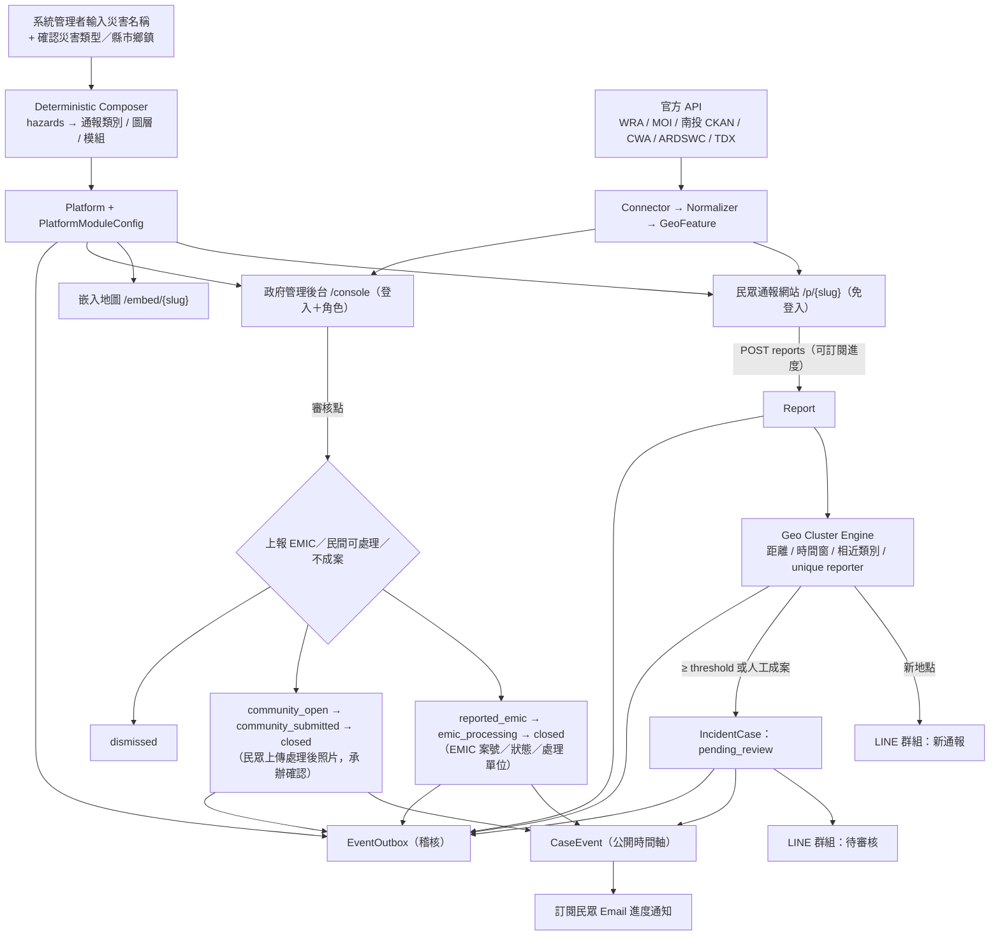

# AidFlow — 系統架構

## 1. 總覽



三個容器（Docker Compose）：`db`（PostgreSQL 16）、`api`（FastAPI，含 media volume）、`web`（Next.js）。

## 2. 後端分層

```text
apps/api/app/
├── domain/      純規則，無 I/O：categories、hazards、case_states（enum + transitions + tracks）、
│                permissions（角色 → 權限）、emic（EMIC 暫定欄位對照）
├── core/        config（環境變數）、security（Bearer 權杖／服務金鑰 → Principal、require(perm)）
├── modules/     ModuleSpec / registry / aidflow_modules / scenarios（compose_profile）
├── services/    platform_service（composer）、report_service、cluster_service、case_service（審核／EMIC／民間處理）、
│                auth_service、notification_service、line_service、privacy_service、situation_service、
│                official_data_service、media_service、demo_seed_service、outbox_service
├── connectors/  官方資料（nantou_open_data、moi_shelters、moi_population、wra、cwa、ncdr、ardswc、tdx、taipower）
│                ＋ 對外管道 line（群組推播／webhook 簽章）、mailer（SMTP）、emic
├── routers/     public（開放）、auth（登入／帳號／稽核）、platforms、cases、modules、demo、line（webhook）
├── schemas/     Pydantic 合約
└── db/          SQLAlchemy models；alembic/ migrations
```

- routers 只做 HTTP、權限檢核（`Depends(require(Perm.…))`）與錯誤對應；services 擁有交易邊界；domain 與 connectors 的 normalizer 可離線單元測試。
- 系統不呼叫任何 LLM。平台建立時「依災害名稱建議災害類型」為關鍵字規則（`hazards.detect_hazards`），由人確認。
- 通知永遠在交易 commit **之後**才送（`case_service.after_commit`、`report_service._notify_after_intake`），不會通知一個已回滾的變更。

## 3. 資料模型

| 表 | 用途 |
| --- | --- |
| `platforms` | 一場災害一個平台：slug、名稱（災害名稱）、county/towns、hazards、scenario 快照、modules、layers、configuration（cluster_policy、map、line_group_id、line_bind_code）、status |
| `platform_module_configs` | 每平台的模組啟用與設定（`two_report_trigger` 存成案規則） |
| `reports` | 民眾通報；`reporter_key` 為加鹽雜湊；選填 `reporter_name`／`reporter_contact`（電話）／`reporter_email`，三欄以 AES-256-GCM 加密保存（`app/db/crypto.py`，0015 將既有資料加密）；`notify_opt_in` 與取消用的 `notify_token` |
| `report_clusters` | 同災點通報聚類：centroid、report_count、unique_reporter_count、status（open/promoted/closed/dismissed） |
| `incident_cases` | 案件；`status` 為 `CaseStatus`；`track`（emic/community）；審核 `reviewed_by/at`；EMIC `emic_case_no`、`emic_status`、`emic_channel`（manual/api）、`emic_reported_at/synced_at`；`assigned_unit`（EMIC 處理單位）；`community_submitted_at`；`closed_at` |
| `case_events` | 案件歷史；`public=true` 的列構成公開時間軸 |
| `report_photos` | 照片 metadata（bytes 在 MEDIA_ROOT，已去除 EXIF）；kind = scene/before/after，source = citizen/agency |
| `users` | 政府人員帳號：Argon2 雜湊、role、active、failed_attempts／locked_until、token_version、must_change_password |
| `notification_logs` | LINE／Email 通知紀錄：kind、遮罩後收件者、sent/simulated/failed/skipped |
| `line_groups` | LINE 機器人加入過的群組與綁定的平台 |
| `event_outbox` | 交易型 outbox，所有領域與安全事件（稽核） |

Migrations：`0010` 建立核心表；`0011` 移除 ResQLink 專屬表；`0012` 調整案號唯一性；`0013` 派遣／車輛（已由 `0014` 移除）；`0014_review_emic_auth` 把舊狀態對應到新流程（曾派工的案件視為 EMIC 軌道）、新增上述欄位與表、刪除 `case_assignments`／`responder_units`／`vehicle_positions`（downgrade 可重建）。

## 4. 同地點多人回報成案（deterministic）

```text
report(lat, lon, category, reporter_key, created_at)
  → bbox 預篩 open/promoted clusters（同平台）
  → pick_cluster: 相近類別 ∧ last_reported_at 在 time_window 內 ∧ haversine ≤ radius，取最近
  → 無 → 開新 cluster（commit 後推播 LINE「新通報」）
  → 重算 centroid / report_count / unique_reporter_count（同 reporter_key 只計一次）
  → cluster.case_id 為空 ∧ unique ≥ required → create_case_from_cluster（status pending_review；推播「待審核」）
  → cluster 已成案 → attach_report_to_case（公開時間軸多一筆「第 N 筆民眾回報」）
```

未達門檻的地點在後台「未成案地點」可「人工成案」，同樣進入待審核。

## 5. 案件狀態機與審核點

```text
pending_review ──上報 EMIC──▶ reported_emic ──▶ emic_processing ──▶ closed
      │                            ▲                                  ▲
      ├──民間可處理──▶ community_open ──民眾上傳照片──▶ community_submitted ─┤（承辦確認通過）
      │                    ▲   │（改列上報）              │（不通過：退回） │
      │                    └───┼────────────────────────┘                │
      │                        └──▶ reported_emic                         │
      └──不成案──▶ dismissed          community_open ──承辦直接結案────────┘
```

- `domain/case_states.py` 是唯一真相來源：`TRANSITIONS`、`PUBLIC_LABELS`、`PUBLIC_PHASE`（pending／active／community／done／dismissed）、`TRACK_OF`、各軌道的 `PROGRESS_PATHS`。
- `case_service.review` 實作審核點；`report_to_emic` 在 `EMIC_SUBMIT_URL` 設定時以 JSON 上報（欄位對照 `domain/emic.py`），失敗或未設定則為人工登錄模式並在結果說明；`update_emic` 登錄 EMIC 案號（內部）、處理狀態與處理單位（公開）；`community_submit`／`community_confirm` 處理民眾協助。
- 結案（closed）與不成案（dismissed）的案件及其通報不出現在公開地圖；結案案件仍可由連結開啟（訂閱者信件）。

## 6. 身分驗證與權限

- `core/security.get_principal`：`Authorization: Bearer`（有效帳號）→ `X-API-Key`（服務，全部權限）→ `AUTH_REQUIRED=false` 時的開發模式 → 否則 401。
- `domain/permissions.py`：承辦審核人員（view_console、review_cases、view_pii）、業務主管（view_console、view_pii、view_audit）、系統管理者（view_console、manage_platforms、manage_line、manage_users、view_audit）。
- `auth_service`：Argon2id、JWT（含 token_version）、連續失敗鎖定、首次啟動以 `INITIAL_ADMIN_*` 建立管理者、不可停用最後一位管理者。
- 前端 `lib/auth.ts` 快取 `/v1/auth/me`；`ConsoleShell` 是登入守門（未登入導向 `/login`、必須改密碼導向 `/console/account`、閒置 30 分鐘登出），並依權限顯示導覽與按鈕。

## 7. 通知

| 事件 | 對象 | 管道 |
|---|---|---|
| 新地點的第一筆通報（或無座標通報） | 縣府 LINE 群組 | `notification_service.staff_new_report` |
| 案件進入待審核 | 縣府 LINE 群組 | `staff_review_needed` |
| 民眾回報已協助處理 | 縣府 LINE 群組 | `staff_community_submitted` |
| 案件狀態變更（含成案） | 勾選接收進度的通報民眾 | `notify_reporters`（Email，附取消連結） |

- LINE 群組綁定：管理者取得 6 碼代碼，把機器人邀進群組並輸入「綁定 代碼」；`/v1/line/webhook` 驗證簽章後綁定（`line_service`）。也可手動輸入群組 ID。
- 未設定憑證 → `simulated`；平台未綁群組 → `skipped`；實際送出在短暫背景執行緒進行，結果寫入 `notification_logs`。

## 8. 隱私分離

| | 內部 API（登入） | 公開 API `/v1/public` |
| --- | --- | --- |
| 座標 | 精確 | 四捨五入至 3 位小數（≈110 m） |
| 地址 | 具 view_pii 權限者看原文；其他遮罩 | `mask_address`：去門牌／巷弄／樓層 |
| 姓名／電話／Email | 僅 view_pii 角色於案件／單筆通報可見，並寫入 `pii.viewed`；清單一律不含 | 不輸出；自由文字經 `redact_text` |
| EMIC 案號 | 可見 | 不輸出（處理狀態與處理單位公開） |
| 案件事件 | 含內部備註 | 僅 `public=true` |
| 照片 | 全部（已去 EXIF） | `public=true` |

## 9. 官方資料層

```text
Government API → connectors/<source>.fetch_*() → map_*()（純函式，離線測試）→ GeoFeature[]
  → official_data_service.get_layer(platform, layer)（TTL 快取、狀態 ok / disabled / unavailable / not_enabled）
  → /v1/public/platforms/{slug}/layers/{layer} → TerrainMap
```

憑證不存在 → `ConnectorDisabled` → 圖層 `disabled`；上游錯誤 → `ConnectorError` → `unavailable`。兩者都不會產生假資料。政府網站憑證缺少 Subject Key Identifier 時，`connectors/base.py` 只關閉 OpenSSL 的 strict profile，鏈與主機名驗證維持開啟。

第二波來源：`ardswc.py`（警戒 JSON＋年度 SHP，TWD97→WGS84）、`tdx.py`（CCTV、路況消息）、`moi_population.py`、`taipower.py`、`cwa.py` 雷達回波（後端裁切縮圖、WebP 快取回放）、`wra.py` 水庫。水庫與停電位置為鄉鎮示意（`indicative`）。

## 10. 前端

- `app/p/[slug]`：地圖首頁（狀態列：目前災情／審核中／處理中／民眾可協助；可選資料圖層；右側或底部案件面板；地圖上醒目的「我要通報災情」）、處理進度清單、案件頁（進度條依軌道、EMIC 狀態、「我來協助處理」表單）、通報表單（大字、GPS、照片、選填 Email 訂閱與個資告知）。
- `app/embed/[slug]`：無站框的嵌入地圖；`next.config.js` 只允許 `EMBED_ALLOWED_ORIGINS` 以 iframe 嵌入 `/embed/*`，其他頁面 `frame-ancestors 'self'`。
- `app/console`：災害平台清單、平台後台（嚴重程度分級卡、LINE 綁定狀態橫幅、地圖＋待審核／EMIC／民眾協助／已結案佇列、未成案地點、通知紀錄、成案規則、官方情資）、案件工作台、建立平台、帳號管理、稽核紀錄、變更密碼。
- 字級：依縣府「字大一點」需求，Tailwind 文字級距整體放大一級，固定像素字級＋2px，按鈕與輸入框加高。
- `components/TerrainMap`：MapLibre GL，OpenFreeMap 向量底圖（中文標籤）＋ AWS Terrain Tiles 3D 地形；案件標竿（顏色＝類別、外圈＝處理階段、數字＝回報人數）、未成案聚類、去識別化通報、熱區、官方圖層、雷達回放。

### 3D 地圖效能守則

開啟地形後 MapLibre 會把非符號圖層烘焙進每塊地磚的貼圖，任何每幀變動的資料或樣式都會讓地磚整疊重畫。`TerrainMap` 因此：資料更新拆成案件／官方圖層兩條獨立路徑；畫布像素比上限 1.25；俯角 46°；地形與山影共用同一個 DEM source；拖動或縮放期間暫停雷達回放；DOM 標竿停用對地形深度緩衝的逐幀讀回（`readPixels`）。

地形高程造成的鏡頭偏移：`flyTo({center})` 的 center 是水平座標，開啟 3D 地形後高海拔案件會投影到畫面中心上方；`TerrainMap` 在 `moveend` 後以 `map.project()` 量測實際落點並 `panBy` 修正。

### 傳輸成本

所有輪詢在 `document.hidden` 時暫停；地圖資料以內容簽章（`featureSignature`）比對，內容相同就不重新上傳 GPU 緩衝；官方情資只在分頁開啟時抓取；雷達影像裁切縮圖並以 `max-age=86400, immutable` 快取。

## 11. 示範資料

`demo_seed_service` 以真實 pipeline 重播南投豪雨情境（通報 → 聚合 → 成案 → 審核 → EMIC 登錄／民眾協助 → 結案），時間戳回推；`seed_into_platform` 可把同一故事帶入任何平台，非南投縣以鄉鎮為單位平移座標並改寫地址（見 `_site_transform`：鄉鎮參考點、依縣市幾何決定位移上限、同鄉鎮共用縮放係數，不會落海、不會捏造不存在的鄉鎮）。

`DEMO_MODE` 開啟時，建立的平台只保留最新 `DEMO_KEEP_GENERATED` 個（內建南投示範平台永遠保留；同一請求剛建立的平台不會被清掉）。

### 鄉鎮參考點（全國 368 個）

`app/utils/town_centroids.py` 是**產生出來的**，不要手改。來源是內政部消防署「避難收容處所點位檔」(data.gov.tw 73242)：每個鄉鎮市區取該轄內所有收容處所座標的中位數。重新產生：

```bash
cd apps/api
python scripts/derive_town_centroids.py out.json
python scripts/render_town_centroids.py out.json app/utils/town_centroids.py
```
